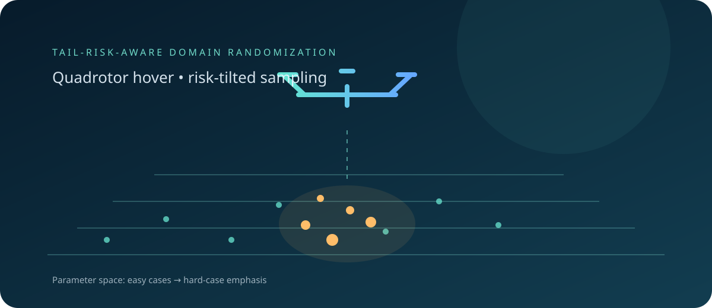

# Tail-Risk-Aware Domain Randomization

<div align="center">
  
</div>

**[Project homepage](https://paoshou-china.github.io/TRADR/)** · [Quick start](#usage) · [Method](#core-idea)


Minimal demo of iterative **Entropic Risk Reweighting** for domain randomization (DR) in a quadrotor hover task. It uses Genesis for GPU-parallel simulation and `rsl_rl` for PPO.

## Core idea

Standard DR samples dynamics parameters uniformly. Entropic risk reweighting evaluates the policy over a parameter grid, then assigns greater probability to low-return (hard) parameter regions:

```
q(θ) ∝ exp(−β · R(θ))
```

A dual variable β is updated to keep KL(q || uniform) near a target.

## Requirements

- Linux with an NVIDIA GPU and a CUDA-compatible PyTorch installation.
- Python 3.10 or newer (use a version supported by your installed Genesis and rsl_rl releases).
- Genesis, rsl_rl, PyTorch, NumPy, and TensorDict. See `requirements.txt` for the Python package list.
- Install a PyTorch build matching your CUDA runtime before installing the remaining packages. Genesis GPU simulation does not have a CPU fallback in this demo.

## Install

```bash
python -m venv .venv
source .venv/bin/activate
python -m pip install --upgrade pip
# Install the PyTorch build matching your CUDA version from pytorch.org.
python -m pip install -r requirements.txt
```

## Usage

```bash
# Iterative method: 20 rounds, 50 PPO iterations per round
python run.py

# Uniform DR baseline
python run.py baseline

# Smaller illustrative run
python run.py iterative --rounds 2 --iters_per_round 5 --num_envs 256 --eval_envs 128 --episodes_per_eval 1
```

The small run is for checking basic setup and output flow; it is not a performance evaluation. Training and evaluation allocate GPU environments, so start with small values if GPU memory is limited.

### Arguments

| Argument | Default | Meaning |
|---|---:|---|
| `mode` | `iterative` | `baseline` or `iterative` |
| `--num_envs` | 2048 | Parallel training environments |
| `--seed` | 1 | Training seed |
| `--max_iters` | 1000 | Baseline PPO iterations |
| `--rounds` | 20 | Iterative training rounds |
| `--iters_per_round` | 50 | PPO iterations in each iterative round |
| `--eval_envs` | 10000 | Evaluation parameter grid size |
| `--episodes_per_eval` | 15 | Episodes per evaluation parameter point |
| `--target_kl` | 2.0 | Target KL for the dual-β update |

The default iterative run evaluates 10,000 parameter points for 15 episodes per point after each round; this can be computationally expensive. The CLI currently exposes `target_kl`; β learning rate and ESS safeguards remain defined in the training implementation.

## Outputs

Results are written under `logs/<experiment>_<algorithm>/`. Iterative runs save round checkpoints such as `model_50.pt`, plus `eval_history.json` and `eval_history.pkl`. The baseline writes checkpoints and evaluation history under its baseline output directory. The first iterative round removes an existing directory with the same run name, so back up any results before reusing that name.

## DR parameters

The randomized parameters include mass, inertia, center-of-mass offset, thrust coefficient, and turbulence disturbance. Their ranges and implementation are defined in `hover_train.py` and `hover_env.py`.
